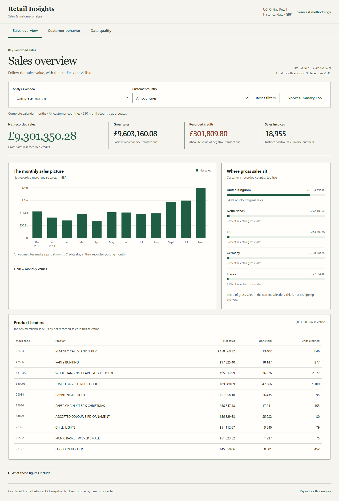
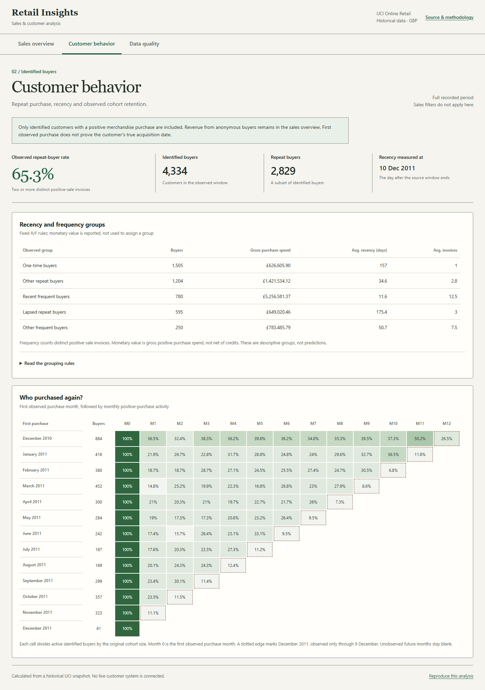

# Retail Insights

Analisis penjualan dan perilaku pembeli dari UCI Online Retail dengan Python, pandas, dan DuckDB SQL. Hasilnya tersedia sebagai dashboard web, notebook analisis, serta CSV agregat dengan query Power Query M dan measure DAX untuk Power BI.

Proyek menjawab berapa nilai penjualan setelah kredit, bagaimana revenue tersebar menurut waktu/negara/produk, serta bagaimana pembeli teridentifikasi kembali membeli. Definisi metrik, keputusan pembersihan, dan batas interpretasi dijelaskan agar angka bisa diperiksa dari sumbernya.

## Tampilan dashboard

| Sales overview | Customer behavior |
| --- | --- |
| [](docs/screenshots/01-overview.png) | [](docs/screenshots/02-customers.png) |

Overview pada screenshot memakai bulan penuh; pelanggan memakai seluruh periode. Lihat juga [audit kualitas data](docs/screenshots/03-quality.png) dan [tampilan mobile](docs/screenshots/04-mobile.png).

## Hasil dari data resmi

Angka di bawah memakai seluruh periode **1 Desember 2010 sampai 9 Desember 2011**, termasuk bulan terakhir yang parsial. Tampilan awal dashboard memakai 12 bulan penuh, sehingga total awalnya berbeda. Sumber angka: [KPI hasil build](reports/kpis.json) dan [CSV agregat](reports/exports/monthly_country.csv).

| Metrik | Seluruh periode |
| --- | ---: |
| Gross merchandise sales | GBP 10,216,121.27 |
| Recorded merchandise credits | GBP 475,901.16 |
| Net merchandise sales | GBP 9,740,220.11 |
| Invoice penjualan positif | 19,771 |
| Pembeli teridentifikasi | 4,334 |
| Pembeli teridentifikasi yang membeli ulang | 2,829 (65.27%) |

Kredit tercatat bernilai 4.66% dari gross sales. Rasio ini belum menunjukkan tingkat retur fisik karena kredit tidak dicocokkan ke pesanan asal. Gross sales sebesar GBP 1,478,893.63 tidak mempunyai CustomerID; nilainya tetap masuk revenue dan berada di luar RFM/cohort. Di antara bulan penuh, November 2011 mencatat net sales tertinggi sebesar GBP 1,423,188.80. Semua temuan bersifat historis dan deskriptif, dengan rincian cakupan pada [laporan temuan](reports/FINDINGS.md).

## Menjalankan dashboard

Setup analisis memerlukan Python 3.13 atau lebih baru. Verifikasi model dashboard juga memerlukan Node.js; lingkungan pengerjaan memakai Python 3.13.1 dan Node.js 22.14.0. Dependensi Python dipatok pada [requirements.txt](requirements.txt). Dashboard dibuka melalui browser dan tidak memerlukan build frontend atau server Jupyter.

Untuk melihat snapshot dashboard, cukup Python yang sudah terpasang. Jalankan dari root repositori di PowerShell:

```powershell
.\scripts\Start.ps1
```

Buka **http://127.0.0.1:8103**. Tekan Ctrl+C pada terminal untuk menghentikan server. Ganti port bila diperlukan dengan `.\scripts\Start.ps1 -Port 8110`. Server hanya menyajikan folder dashboard pada loopback.

Snapshot agregat yang disertakan membuat dashboard dapat dibuka tanpa mengunduh Excel. Filter awal memakai bulan penuh Desember 2010 sampai November 2011. Pilih *Full recorded period* untuk menyertakan Desember 2011 yang baru teramati sampai tanggal 9. Filter bulan dan negara mengubah sales overview dan produk; pelanggan/cohort tetap global sepanjang periode dan diberi label cakupan.

## Mereproduksi analisis

Setup menyiapkan virtual environment lokal serta dependensi Python. Build mengunduh workbook resmi, mencatat SHA-256, memeriksa schema/jumlah baris/periode, menjalankan SQL, dan menulis ulang ekspor. Verify menjalankan pengujian Python/SQL, model JavaScript, validasi snapshot resmi, dan seluruh sel notebook:

```powershell
.\scripts\Setup.ps1
.\scripts\Build.ps1
.\scripts\Verify.ps1
```

Untuk memperbarui output notebook setelah build:

```powershell
.\.local\venv\Scripts\python.exe scripts/execute_notebook.py --write
```

Untuk memanggil pipeline langsung setelah setup:

```powershell
.\.local\venv\Scripts\python.exe scripts/download_data.py
.\.local\venv\Scripts\python.exe scripts/build.py
```

Build resmi memerlukan koneksi internet saat sumber belum tersedia. Workbook transaksi dan database DuckDB lokal diabaikan oleh Git; CustomerID tidak dimasukkan ke hasil publik. [source.json](data/source.json) menyimpan identitas sumber, sedangkan [kpis.json](reports/kpis.json) menyimpan hasil agregat serta status rekonsiliasi.

Fixture sintetis tersedia untuk belajar aturan secara offline dan selalu memakai output terpisah:

```powershell
.\.local\venv\Scripts\python.exe scripts/build.py --sample --output-root .local/sample-output
```

Fixture bukan data bisnis resmi dan tidak boleh dipakai sebagai temuan portofolio. Lihat [CODE-GUIDE](docs/CODE-GUIDE.md) untuk hubungan setiap file dan fungsi.

## Apa yang dihitung

| Area | Isi | Keputusan yang perlu diketahui |
| --- | --- | --- |
| Penjualan | Gross sales, credits, net sales, orders, unit | Net adalah gross dikurangi kredit tercatat, bukan profit |
| EDA | Tren bulan penuh, konsentrasi negara, ranking SKU | Negara berarti tempat tinggal pelanggan; Desember 2011 parsial |
| Pelanggan | Recency, frequency, gross monetary spend; kelompok R/F; repeat buyer rate | Hanya pembeli dengan ID pada penjualan positif; seluruh periode |
| Cohort | Aktivitas bulanan setelah first observed purchase | Bulan 0 = 100%; masa depan kosong; bukan true acquisition |
| Kualitas | Duplikasi, alasan eksklusi, missing ID, rekonsiliasi | Missing ID tetap masuk revenue jika barisnya valid |

Pembersihan menghapus baris yang identik pada delapan kolom, membatasi merchandise ke pola SKU yang didefinisikan, serta memisahkan kredit dari penjualan positif. Harga satuan dinormalisasi ke empat desimal dengan HALF_UP sebelum dikali kuantitas integer, lalu disimpan sebagai DECIMAL(18,4). [Metodologi](docs/METHODOLOGY.md) menjelaskan aturan dan konsekuensinya.

Build resmi membaca 541,909 baris, menghapus 5,268 salinan identik, lalu memisahkan 536,641 baris menjadi 520,562 baris sale, 8,668 baris credit, dan 7,411 baris eksklusi. Rekonsiliasi baris serta nilai uang lulus. [Notebook](notebooks/01_retail_analysis.ipynb) menyimpan output eksekusi dari ekspor resmi dan mengulang pemeriksaan agregat dengan Decimal.

## Power BI

[Paket Power BI](powerbi/README.md) berisi query M yang benar-benar tersedia, definisi DAX, schema CSV, dan panduan relasi/filter. Ikuti [langkah impor](docs/POWER-BI.md) untuk membangun laporan native di Power BI Desktop.

Paket ini adalah materi impor yang siap dipakai dari hasil pipeline. Repositori tidak mengklaim menyertakan PBIX/PBIP atau hasil validasi visual di Power BI Desktop. Laporan yang langsung dapat dijalankan adalah dashboard web.

## Belajar dan meninjau kode

- [Panduan per file dan fungsi](docs/CODE-GUIDE.md): aliran data, Python, SQL, JavaScript, dan Power BI.
- [Metodologi](docs/METHODOLOGY.md): definisi KPI, seleksi merchandise, kredit, RFM, cohort, dan periode setara.
- [Notebook analisis](notebooks/01_retail_analysis.ipynb): pandas dan DuckDB SQL dari CSV publik, dengan pemeriksaan uang/baris/cohort.
- [Panduan wawancara](docs/INTERVIEW.md): pertanyaan bisnis, jawaban teknis, dan urutan demo.
- [Temuan hasil eksekusi](reports/FINDINGS.md): hasil query dengan cakupan, tanpa klaim kausal.

| Lokasi | Tanggung jawab |
| --- | --- |
| [scripts/](scripts/) | Setup, download, build, verifikasi, dan server lokal |
| [src/retail_insights/](src/retail_insights/) | Normalisasi, orkestrasi pipeline, audit, dan ekspor |
| [sql/](sql/) | Seleksi baris, agregat penjualan, pelanggan, dan cohort |
| [dashboard/](dashboard/) | Antarmuka HTML/CSS/JavaScript tanpa build frontend |
| [reports/exports/](reports/exports/) | CSV agregat untuk notebook dan Power BI |
| [tests/](tests/) | Kasus aturan Python/SQL dan ekspor |
| [dashboard/tests/](dashboard/tests/) | Pengujian filter, hitungan, validasi snapshot, dan CSV di JavaScript |

## Sumber dan batas penggunaan

[Chen, D. (2015). Online Retail. UCI Machine Learning Repository](https://doi.org/10.24432/C5BW33), [halaman dataset](https://archive.ics.uci.edu/dataset/352/online+retail). Data berlisensi [CC BY 4.0](https://creativecommons.org/licenses/by/4.0/). Proyek mengubah data melalui deduplikasi, seleksi merchandise, normalisasi tipe/harga, serta agregasi. Periode sumber 1 Desember 2010 sampai 9 Desember 2011; seluruh nilai uang adalah GBP historis.

Dataset tidak menyediakan biaya, inventory, exposure kampanye, atau riwayat sebelum awal observasi. Hasil tidak mengukur profit, margin, dampak kausal, true acquisition, atau permintaan saat ini. Kredit tercatat tidak dicocokkan ke pesanan asal dan tidak dianggap sebagai tingkat retur fisik yang terverifikasi.
