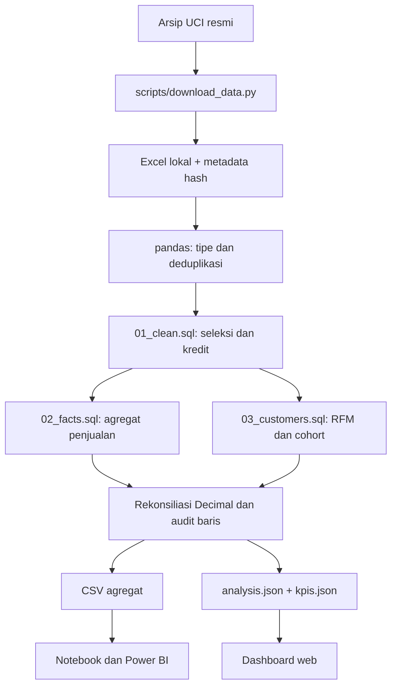

# Panduan kode per file dan fungsi

Mulai dari [metodologi](METHODOLOGY.md) untuk memahami definisi metrik, lalu ikuti panduan ini sambil membuka kode. Panduan ini menjelaskan implementasi yang ada, termasuk batas yang sengaja dipertahankan.

## Aliran data

Excel dan database lokal berisi detail transaksi. CSV/JSON publik hanya memuat agregat. Notebook membaca ekspor publik; perhitungan pelanggan per ID berlangsung di pipeline lokal.

## Mengunduh dan menjalankan build

[Setup.ps1](../scripts/Setup.ps1) memeriksa Python minimal 3.13, membuat virtual environment lokal, memasang versi yang dipatok pada [requirements.txt](../requirements.txt), dan menjalankan pip check. Folder sementara/cache berada di dalam proyek; variabel environment proses dikembalikan sesudah skrip selesai. [Build.ps1](../scripts/Build.ps1) mengurutkan download dan build, atau menjalankan fixture dengan parameter `-Sample`.

[download_data.py](../scripts/download_data.py) mengambil arsip resmi, membatasi ukuran unduhan, mengekstrak hanya workbook yang diharapkan, dan menulis [source.json](../data/source.json). Metadata mencatat URL, lisensi, jumlah baris yang diharapkan, periode, ukuran file, dan SHA-256.

| Fungsi | Cara kerjanya | Alasan |
| --- | --- | --- |
| `digest(path)` | Membaca file secara bertahap dan menghitung SHA-256 | Memeriksa identitas file tanpa mencetak datanya |
| `download(force=False)` | Mengunduh jika perlu, memeriksa entri ZIP, mengekstrak workbook, membandingkan hash lama, lalu menulis metadata | Perubahan sumber tidak diterima diam-diam |

Opsi `--force` berarti menerima ulang sumber setelah meninjau perubahan. Ini bukan opsi yang diperlukan pada pemakaian normal. Jika hash berubah, periksa sumber sebelum menggunakannya.

[build.py](../scripts/build.py) adalah antarmuka CLI. File ini menyiapkan path impor modul, membaca argumen, memilih sumber resmi atau fixture, lalu memanggil `build_analysis`. Mode resmi memeriksa jumlah baris dan hash. Mode `--sample` memakai [fixture sintetis](../data/sample/online_retail_sample.csv) dan menulis ke folder output terpisah. Fixture menguji aturan, bukan pengganti temuan bisnis resmi.

## Modul pipeline Python

Semua fungsi berikut berada di [pipeline.py](../src/retail_insights/pipeline.py). Urutan membacanya paling mudah dimulai dari `build_analysis`, kemudian mengikuti fungsi yang dipanggil.

| Fungsi | Input dan hasil | Detail yang perlu dipahami |
| --- | --- | --- |
| `text(value)` | Nilai sumber menjadi teks bersih atau None | Angka integer yang terbaca sebagai float tidak diberi akhiran `.0`; string kosong menjadi None |
| `integer(value)` | Kuantitas sumber menjadi integer valid atau None | Menolak pecahan, nilai tak hingga, dan nilai di luar batas implementasi |
| `price(value)` | Harga sumber menjadi string Decimal empat desimal atau None | Memakai `Decimal(str(value))` dan HALF_UP sebelum dikali kuantitas; harga tidak valid tidak diganti nol |
| `connect(database)` | Path database menjadi koneksi DuckDB | Mengatur jumlah thread dan batas memori untuk proses lokal |
| `load_frame(connection, original)` | DataFrame delapan kolom menjadi tabel normalisasi dan hitungan audit | Memeriksa urutan kolom, menghapus duplikasi delapan kolom, menormalkan tipe, menjalankan SQL seleksi |
| `records(connection, query, parameters)` | Hasil query menjadi list dictionary | Mempertahankan tipe Decimal dari `fetchall()` sampai tahap serialisasi |
| `scalar(connection, query)` | Query satu nilai menjadi nilai Python | Dipakai untuk hitungan dan invariant sederhana |
| `create_marts(connection)` | Tabel bersih menjadi agregat, RFM privat, segmen, dan cohort | Memastikan invoice positif tidak melintasi bulan/negara, lalu menetapkan tanggal cutoff dan cakupan |
| `to_json(value)` | Decimal/tanggal menjadi tipe yang diterima JSON | JSON uang berupa angka; konsumen dashboard menjumlahkan dalam integer 1/10.000 GBP |
| `write_json(path, value)` | Dictionary menjadi file UTF-8 | Menolak NaN agar snapshot tidak menyimpan angka yang tidak valid |
| `summarize(connection, base_quality, coverage, source)` | Agregat dan metadata menjadi snapshot dashboard | Menyimpan definisi, bulan lengkap/parsial, pelanggan global, cohort, dan kualitas |
| `write_exports(connection, destination, quality)` | Menulis lima CSV agregat | ORDER BY eksplisit menjaga urutan; alasan kualitas diurutkan dan memakai LF agar hasil lintas OS sama |
| `make_findings(connection, customers, months)` | Query hasil analisis menjadi temuan dengan scope | Nilai berasal dari query yang dieksekusi; puncak tren hanya membandingkan bulan penuh |
| `assert_reconciliation(connection, quality)` | Tabel dan audit menjadi pemeriksaan yang gagal jika tidak cocok | Memeriksa audit baris, kesetaraan net detail/overview/produk, gross dikurangi credits, serta cohort bulan nol |
| `build_analysis(input_path, output_root, expected_rows, sample)` | File sumber menjadi database lokal, ekspor, snapshot, dan laporan | Mengorkestrasi seluruh proses; validasi dilakukan sebelum hasil disajikan sebagai analisis |

`COLUMNS` berisi delapan kolom sumber yang diwajibkan. `PRICE_PRECISION` menetapkan empat angka desimal. [__init__.py](../src/retail_insights/__init__.py) menandai modul sebagai paket Python.

`load_frame` mengisi deskripsi kosong dengan `Description unavailable` dan negara kosong dengan `Unknown`. CustomerID kosong tetap kosong. Tanggal yang tidak bisa dibaca menjadi null agar SQL memberi alasan eksklusi. Ini berbeda dari mengisi tanggal atau ID dengan perkiraan.

## SQL pembersihan

[01_clean.sql](../sql/01_clean.sql) membuat `transaction_lines`, `included_lines`, dan `sales_lines`.

`transaction_lines` menambah `exclusion_reason`, `signed_amount`, dan `month`. CASE berhenti pada alasan pertama yang cocok. Oleh karena itu angka per alasan saling eksklusif; urutan aturan merupakan bagian definisi audit.

`included_lines` hanya mengambil baris tanpa alasan eksklusi. Kuantitas positif menjadi sale, kuantitas negatif menjadi credit. `sales_lines` adalah subset positif untuk pesanan dan pelanggan. Kredit tanpa prefiks C tetap masuk kredit jika lolos aturan; invoice C dengan kuantitas positif dikeluarkan sebagai anomali.

Regex SKU membatasi ruang lingkup merchandise. Jika kamus kode bisnis berubah, revisi aturan dan laporkan perubahan definisi sebelum membandingkan hasil lama dengan baru.

## SQL agregat penjualan

[02_facts.sql](../sql/02_facts.sql) menghasilkan dua grain:

| Tabel | Kunci baris | Agregat |
| --- | --- | --- |
| `monthly_country` | month, country | Gross, credits, net, invoice penjualan berbeda, unit positif, unit kredit |
| `monthly_country_product` | month, country, stock_code | Metrik uang/unit yang sama, ditambah deskripsi produk representatif dan invoice per SKU |

CTE `labels` memilih deskripsi yang paling sering muncul untuk setiap SKU, lalu memakai urutan teks untuk memecahkan seri. Nama produk dapat berubah di sumber, sehingga StockCode tetap menjadi kunci produk.

`count(DISTINCT invoice)` menghindari menghitung setiap item sebagai pesanan. `create_marts` memeriksa invoice positif hanya punya satu bulan dan negara, sehingga orders overview aman dijumlahkan. Orders produk tetap tidak dapat dijumlahkan lintas SKU.

## SQL pelanggan dan cohort

[03_customers.sql](../sql/03_customers.sql) pertama membuat `customer_rfm_private`. Tabel ini memakai CustomerID dan hanya disimpan pada database lokal. Recency mengacu ke hari setelah tanggal akhir sumber, frequency menghitung invoice positif berbeda, dan monetary menjumlahkan gross spend.

CASE segmentasi memakai recency dan frequency dengan prioritas yang dijelaskan pada [metodologi](METHODOLOGY.md). `customer_segments` menghapus detail ID dari ekspor dengan merangkum ukuran kelompok, total monetary, serta rata-rata R dan F.

Query cohort memakai beberapa CTE yang mempunyai tugas berbeda:

| CTE | Tugas |
| --- | --- |
| `activity` | Menyisakan satu baris pelanggan per bulan pembelian positif |
| `cohorts` | Mengambil bulan pembelian pertama yang terlihat per pelanggan |
| `sizes` | Menghitung ukuran cohort awal |
| `active_counts` | Menghitung anggota cohort yang aktif pada tiap bulan |

`CROSS JOIN range` membuat kisi cohort dan umur bulan. LEFT JOIN mengisi hitungan aktivitas yang ada. Bulan yang sudah teramati tanpa aktivitas menjadi nol; bulan masa depan tetap null dengan observed false. `cohort_size` berulang pada setiap umur dan tidak boleh dijumlahkan lintas umur.

## Dashboard tanpa build JavaScript

[index.html](../dashboard/index.html) menyediakan tiga view: Sales overview, Customer behavior, dan Data quality. Produk berada di dalam overview. Elemen filter, tabel, loading, error, dan empty state sudah ada di struktur HTML.

[styles.css](../dashboard/styles.css) mengatur layout, ukuran teks, warna, fokus keyboard, serta penyesuaian layar. [app.mjs](../dashboard/app.mjs) menghubungkan snapshot ke elemen halaman:

| Fungsi | Tugas |
| --- | --- |
| `element` | Membuat elemen HTML dan mengisi teks lewat textContent |
| `svg` | Membuat elemen SVG untuk grafik |
| `monthName` | Memformat label bulan dengan timezone UTC agar tidak bergeser hari |
| `table` | Membuat tabel dengan heading dan caption |
| `setView` | Memilih view, memperbarui state tombol, dan memindahkan fokus saat navigasi |
| `renderChart` | Menggambar tren bulanan, termasuk nilai negatif dan tanda bulan parsial |
| `renderCountries` | Menampilkan negara teratas berdasarkan gross sales dalam seleksi |
| `renderSales` | Membaca filter bulan/negara lalu memperbarui KPI, grafik, produk, dan empty state |
| `renderCustomers` | Menampilkan metrik pembeli, kelompok R/F, dan cohort global |
| `renderQuality` | Menampilkan audit baris, hash sumber, dan batas data |
| `load` | Mengambil JSON, memvalidasi snapshot, kemudian mengubah loading menjadi hasil atau error |

Event listener menangani perubahan filter, reset, ekspor CSV, reload setelah error, serta navigasi hash. Filter hanya mengubah sales dan produk. Pelanggan/cohort tidak dihitung ulang karena data publik tidak memuat ID pembeli.

[model.mjs](../dashboard/model.mjs) memisahkan perhitungan dari manipulasi DOM:

| Fungsi | Tugas dan batas |
| --- | --- |
| `scaled` | Mengubah angka GBP menjadi integer unit 1/10.000 dan memeriksa rentang aman |
| `validateSnapshot` | Memeriksa versi schema, provenance, tipe, grain, rekonsiliasi, dan cohort sebelum render |
| `filterRows` | Menerapkan bulan tertentu, semua periode, atau bulan penuh, bersama filter negara |
| `summarize` | Menjumlahkan uang secara scaled integer serta hitungan yang sesuai grain |
| `monthlySeries` | Membentuk seri urut bulan dari baris terpilih |
| `productLeaders` | Menggabungkan SKU dan mengurutkan net sales; membuang orders yang tidak aditif lintas produk |
| `csv` | Menulis ringkasan bulan-negara terpilih dengan quoting dan empat desimal |

Browser tidak membuka workbook. Satu [analysis.json](../dashboard/data/analysis.json) sudah berisi agregat yang diperlukan, sehingga pergantian filter berlangsung lokal setelah pemuatan.

## Server lokal

[Start.ps1](../scripts/Start.ps1) mencari Python virtual environment proyek, lalu menjalankan [serve.py](../scripts/serve.py). Parameter Port mengubah port default 8103.

Pada [serve.py](../scripts/serve.py), kelas `DashboardHandler` mengenali ekstensi modul JavaScript dan `end_headers` menambah header respons. Fungsi `main` menyiapkan server hanya pada loopback `127.0.0.1`, dengan direktori dashboard sebagai root. Menekan Ctrl+C menutup server. File raw dan database berada di luar direktori yang disajikan.

## Notebook, pengujian, dan Power BI

[01_retail_analysis.ipynb](../notebooks/01_retail_analysis.ipynb) membuka CSV agregat dan KPI hasil build. Fungsi kecil `query_frame` menjalankan SQL lalu membentuk DataFrame dari fetchall agar Decimal tetap terjaga. Sel lainnya mengaudit baris, mengulang total uang, meninjau bulan penuh, negara, produk, kelompok pelanggan, serta sensor cohort. Notebook bukan tempat menyimpan ulang data pelanggan per ID.

[test_pipeline.py](../tests/test_pipeline.py) memakai fixture kecil dengan kasus yang sengaja menantang aturan: duplikasi identik, baris mirip yang sah, penjualan anonim, kredit tanpa C, C dengan kuantitas positif, harga bermasalah, kode khusus, pembulatan, invoice lintas grain, dan cohort masa depan. Pemeriksaan ini melindungi definisi bisnis, bukan hanya memastikan kode selesai berjalan. [conftest.py](../tests/conftest.py) menyiapkan path modul untuk pengujian.

[Verify.ps1](../scripts/Verify.ps1) menjalankan pytest, [model.test.mjs](../dashboard/tests/model.test.mjs), [check-data.mjs](../scripts/check-data.mjs), dan [execute_notebook.py](../scripts/execute_notebook.py). Pemeriksaan model menggunakan test runner bawaan Node. Pemeriksaan snapshot membandingkan provenance, periode resmi, total JSON dengan laporan, dan ketiadaan ID pelanggan pada baris publik.

Pada [execute_notebook.py](../scripts/execute_notebook.py), fungsi `execute(path, write)` membaca JSON notebook, menjalankan sel Python berurutan pada namespace yang sama dengan working directory proyek, lalu memulihkan direktori awal. Opsi `--write` menyimpan stdout dan execution_count; tanpa opsi itu hasil notebook hanya diverifikasi. Tidak ada server Jupyter atau dependensi notebook tambahan yang diperlukan.

[package.json](../package.json) menyediakan `npm test` untuk model, `npm run check` untuk snapshot, dan `npm run test:browser` untuk [capture-ui.mjs](../scripts/capture-ui.mjs). Skrip browser memerlukan Playwright, browser yang tersedia, serta dashboard yang sedang disajikan. Skrip tersebut menguji kontrol, download CSV, cakupan pelanggan, layout, error state, dan menyimpan screenshot dari data resmi. Ini pemeriksaan terpisah dari Verify, bukan klaim bahwa pengujian unit saja sudah memeriksa visual.

Query dan measure pada [paket Power BI](../powerbi/README.md) membaca CSV yang sama. Fungsi `fnLoadCsv` memusatkan schema dan konversi tipe. Fact, dimensi, serta tabel global terpisah mengikuti grain yang sama dengan SQL. Lihat [panduan Power BI](POWER-BI.md) untuk langkah membangun visual serta pemeriksaan sebelum menyimpan PBIX.

## Latihan yang aman

Jalankan mode sample ke output terpisah, kemudian ubah satu aturan dan bandingkan hasil sebelum/sesudah. Contohnya: ubah ambang recency, tambahkan satu kasus kuantitas negatif, atau bandingkan gross dan net untuk SKU yang punya kredit. Gunakan fixture saat belajar agar hasil resmi yang dipublikasikan tidak tertimpa.

Saat menjelaskan perubahan, sebutkan aturan yang berubah, metrik yang terpengaruh, dan pemeriksaan yang masih lulus. Jika definisi berubah, jangan menyebut perbedaan angka sebagai perubahan performa bisnis.
