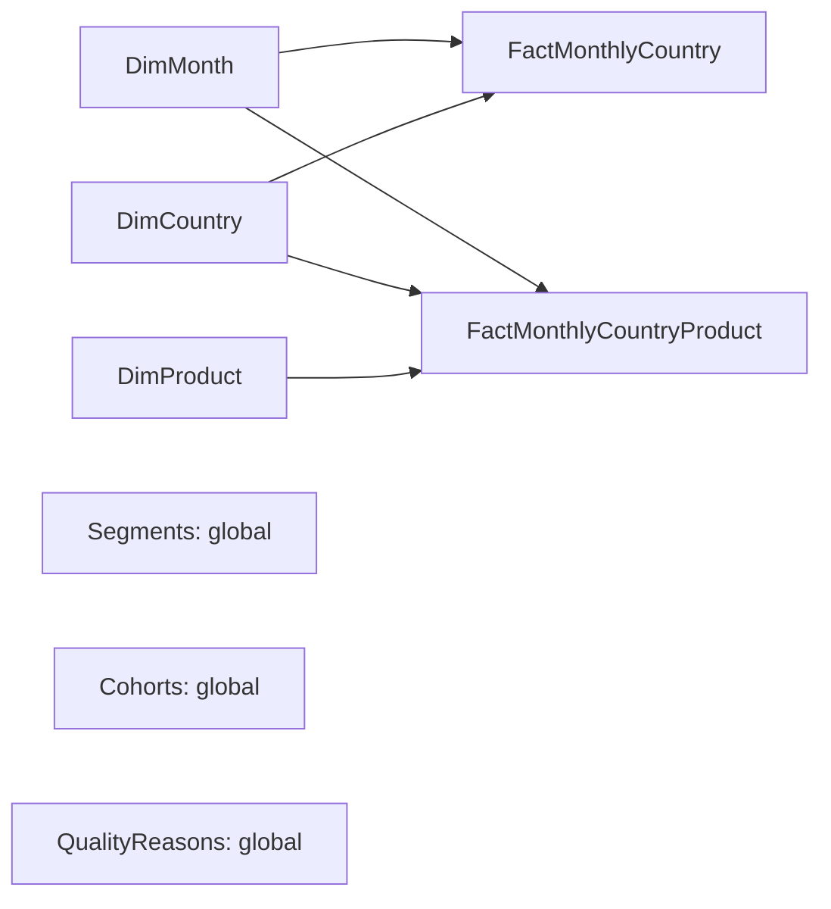

# Membuat laporan dari ekspor agregat

Repositori menyediakan CSV, query Power Query M, measure DAX, dan rancangan relasi untuk diimpor ke Power BI Desktop. Tidak ada file PBIX/PBIP yang diklaim sudah dibangun atau divalidasi di aplikasi Power BI. Dashboard web bisa dipakai langsung; panduan ini adalah langkah membangun laporan native dari hasil yang sama.

## Siapkan data

Jalankan build resmi sesuai [README](../README.md). Pastikan [monthly_country.csv](../reports/exports/monthly_country.csv), [monthly_country_product.csv](../reports/exports/monthly_country_product.csv), [customer_segments.csv](../reports/exports/customer_segments.csv), [cohort_retention.csv](../reports/exports/cohort_retention.csv), dan [quality_reasons.csv](../reports/exports/quality_reasons.csv) tersedia. Gunakan ekspor dari periode dan build yang sama. Jangan mencampur hasil fixture sintetis dengan ekspor resmi.

CSV tidak berisi CustomerID. Konsekuensinya, laporan dapat memfilter metrik penjualan menurut bulan dan negara, tetapi tidak dapat menghitung ulang pembeli unik atau cohort untuk kombinasi filter tersebut. Tabel pelanggan dan cohort tetap global sepanjang periode.

## Buat query Power Query

Di Power BI Desktop, buka Power Query Editor dan buat Blank Query. Beri nama query persis seperti nama file M tanpa ekstensi, lalu salin isi file ke Advanced Editor. Menu aplikasi dapat berbeda menurut versi; semua ekspresi tersedia sebagai file teks agar tetap bisa diperiksa.

1. Buat [BaseFolder](../powerbi/BaseFolder.m). Ganti contoh alamat dengan alamat absolut folder ekspor pada komputer Anda, misalnya folder `reports/exports` dalam clone repositori. Nilai parameter adalah folder, bukan nama CSV.
2. Buat fungsi [fnLoadCsv](../powerbi/fnLoadCsv.m). Fungsi ini membaca UTF-8, memeriksa kolom wajib, mengubah field kosong menjadi null, lalu memberi tipe dengan locale `en-US` agar titik desimal dibaca konsisten.
3. Buat lima tabel [FactMonthlyCountry](../powerbi/FactMonthlyCountry.m), [FactMonthlyCountryProduct](../powerbi/FactMonthlyCountryProduct.m), [Segments](../powerbi/Segments.m), [Cohorts](../powerbi/Cohorts.m), dan [QualityReasons](../powerbi/QualityReasons.m).
4. Buat [DimMonth](../powerbi/DimMonth.m), [DimCountry](../powerbi/DimCountry.m), dan [DimProduct](../powerbi/DimProduct.m). Ketiganya mereferensikan fact sehingga dibuat setelah fact.
5. Terapkan perubahan. BaseFolder dan fnLoadCsv merupakan parameter/fungsi, bukan tabel data yang perlu dimuat ke model. Tinjau relasi yang terdeteksi otomatis dan sisakan hanya relasi di bawah.

Fungsi impor memakai [Csv.Document](https://learn.microsoft.com/en-us/powerquery-m/csv-document). Kolom uang diberi `Currency.Type`, yaitu tipe fixed decimal empat angka di belakang titik menurut [dokumentasi tipe M](https://learn.microsoft.com/en-us/powerquery-m/type-conversion). Nama Currency tidak melakukan konversi kurs; nilai sumber tetap GBP.

DimMonth dibuat khusus untuk cakupan resmi dataset ini. `complete_month = true` hanya untuk Desember 2010 sampai November 2011. Desember 2011 parsial sampai tanggal 9. Jika mengganti dataset atau tanggal sumber, ubah aturan cakupan query tersebut sebelum memakainya.

## Relasi dan cakupan filter

Gunakan relasi 1:* aktif dengan arah filter tunggal dari dimensi ke fact. Nama kolom pada kedua sisi sama:

| Sisi satu | Sisi banyak | Keterangan |
| --- | --- | --- |
| DimMonth[month] | FactMonthlyCountry[month] | Filter overview |
| DimMonth[month] | FactMonthlyCountryProduct[month] | Filter produk |
| DimCountry[country] | FactMonthlyCountry[country] | Filter overview |
| DimCountry[country] | FactMonthlyCountryProduct[country] | Filter produk |
| DimProduct[stock_code] | FactMonthlyCountryProduct[stock_code] | Hanya analisis produk |

Jangan hubungkan dua fact satu sama lain. Biarkan Segments, Cohorts, dan QualityReasons tanpa relasi ke dimensi penjualan. Jangan menghubungkan nama bulan cohort ke DimMonth: cohort_month adalah bulan pembentuk kelompok, sedangkan activity_month adalah bulan aktivitas yang berbeda artinya.

Relasi meneruskan filter mengikuti jalur model; karena itu arah dan grain perlu ditetapkan dengan sengaja. Panduan resmi: [model relationships in Power BI](https://learn.microsoft.com/en-us/power-bi/transform-model/desktop-relationships-understand).

Gunakan slicer DimMonth dan DimCountry pada halaman Overview dan Products. Tempatkan pelanggan/cohort pada halaman sendiri dengan teks `Global: 1 Dec 2010 to 9 Dec 2011; identified buyers only`. Jangan sinkronkan slicer penjualan ke halaman pelanggan. DimProduct hanya memfilter fact produk, sehingga jangan menggunakannya sebagai slicer overview.

## Measure DAX

Salin setiap definisi dalam [measures.dax](../powerbi/measures.dax) sebagai measure tersendiri. Blok `Nama = ekspresi` adalah satu measure; jangan menempel seluruh file ke formula bar sekaligus. `DIVIDE` mengembalikan blank jika denominator nol, sesuai [dokumentasi Microsoft](https://learn.microsoft.com/en-us/dax/divide-function-dax).

Format measure GBP sebagai mata uang GBP dua desimal. Simpan tipe uang sumber tetap fixed decimal empat desimal. Format Credit Value Rate, Segment Buyer Share, Repeat Buyer Rate Global, dan Cohort Retention sebagai persentase. Orders dan jumlah pembeli adalah bilangan bulat.

Beberapa measure sengaja membatasi konteks:

- `Product Orders Single SKU` hanya menampilkan nilai bila tepat satu SKU dipilih melalui DimProduct. Total lintas produk kosong, karena invoice yang sama bisa membeli beberapa SKU. Gunakan DimProduct[stock_code] sebagai baris tabel produk.
- `Identified Buyers Global` dan `Repeat Buyer Rate Global` memakai seluruh kelompok pelanggan. Nilainya tetap global meskipun visual segmen dipilih.
- `Cohort Retention` hanya menghitung satu period_index pada satu waktu. Jika beberapa cohort dipilih pada periode yang sama, measure membagi total pembeli aktif dengan total ukuran cohort yang teramati. Measure tidak menjumlahkan ukuran cohort lintas periode.
- Future cohort tetap blank. Jangan mengganti blank dengan 0 atau mengaktifkan aturan visual yang menyamakan keduanya.

## Rancangan halaman

| Halaman | Visual dan field | Catatan yang harus terlihat |
| --- | --- | --- |
| Overview | Card Net Sales GBP, Gross Sales GBP, Credits GBP, Orders, Gross AOV GBP; line DimMonth[month] dan Net Sales GBP; bar DimCountry[country] dan Net Sales GBP | GBP historis, definisi net, bulan Desember 2011 parsial |
| Products | Tabel DimProduct[stock_code], DimProduct[description], Product Net Sales GBP, Product Credits GBP, Product Credit Value Rate, Product Orders Single SKU | Jumlah pesanan produk tidak dapat dijumlahkan lintas SKU |
| Customers | Card Identified Buyers Global dan Repeat Buyer Rate Global; bar Segments[segment] dan Segment Buyers; tabel monetary, avg_recency_days, avg_frequency | Global; kelompok berdasarkan R/F; monetary adalah gross spend sebelum kredit |
| Cohorts | Matrix Cohorts[cohort_month] pada Rows, Cohorts[period_index] pada Columns, Cohort Retention pada Values | First observed purchase, month 0 = 100%, blank = belum teramati, Desember 2011 parsial |
| Data quality | Tabel QualityReasons[reason] dan jumlah rows; card Rows After Dedup Global dan Excluded Rows Global | Alasan eksklusif setelah deduplikasi; missing ID bukan alasan eksklusi revenue |

Untuk grafik bulanan yang dapat dibandingkan penuh, filter DimMonth[complete_month] menjadi true. Buat grafik semua bulan terpisah jika ingin menampilkan Desember 2011 dengan label parsial. Matrix cohort sebaiknya mematikan grand total kolom lintas period_index; measure juga mengembalikan blank pada konteks tersebut.

## Pemeriksaan sebelum menyimpan PBIX

Bandingkan nilai global tanpa filter dengan [kpis.json](../reports/kpis.json). Revenue Reconciliation GBP harus nol. Total Product Net Sales GBP harus sama dengan Net Sales GBP pada filter bulan-negara yang sama. Orders overview dapat dijumlahkan karena pipeline menolak invoice positif yang melintasi bulan atau negara.

Pastikan jumlah Segments[customers] sama dengan identified_buyers global. Pada cohort, month 0 harus 100% untuk setiap cohort, sel masa depan harus blank, dan Desember 2011 harus tetap diberi keterangan parsial. Hasil yang berbeda berarti perlu memeriksa tipe, relasi, filter, dan build sumber sebelum menafsirkan visual.

Simpan file PBIX Anda setelah pemeriksaan tersebut. Paket dalam repositori ini telah disiapkan sebagai kode impor; menjalankan ekspresi M/DAX dan memeriksa visual secara native masih memerlukan Power BI Desktop.
